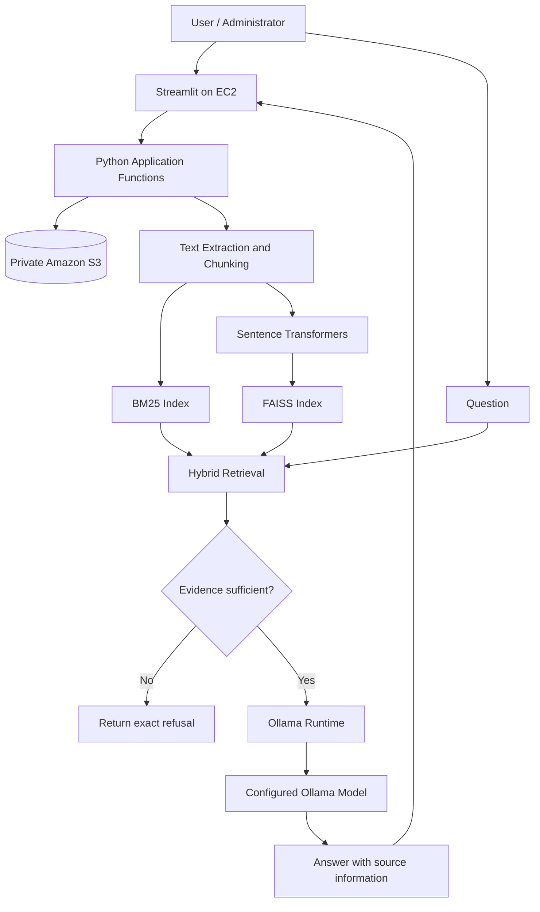
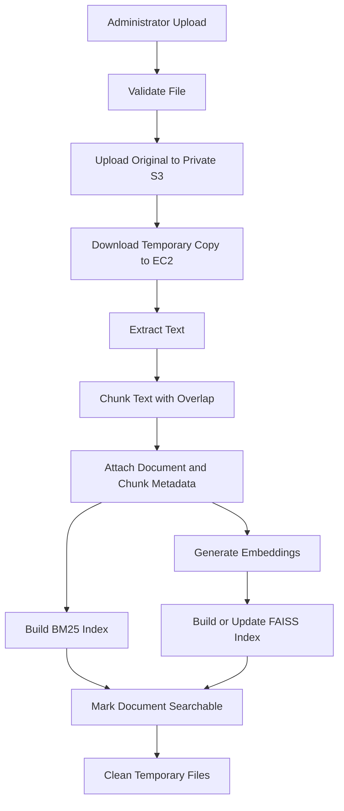
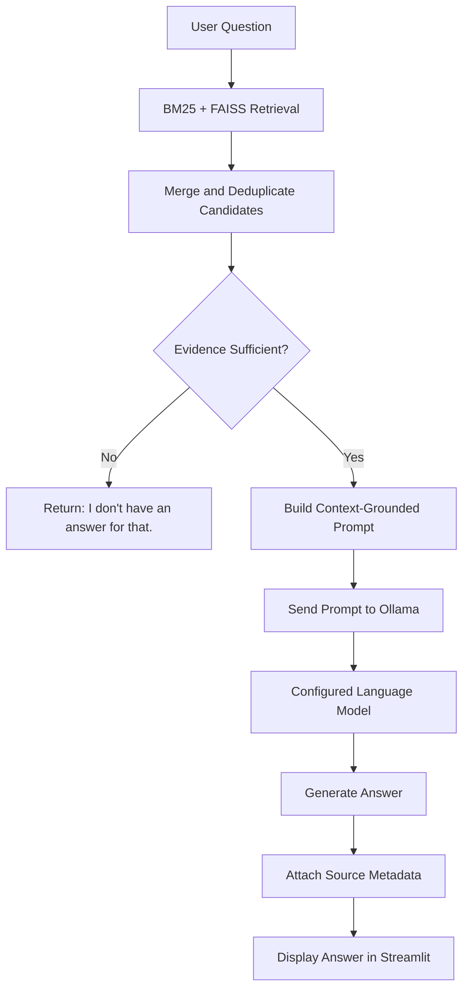
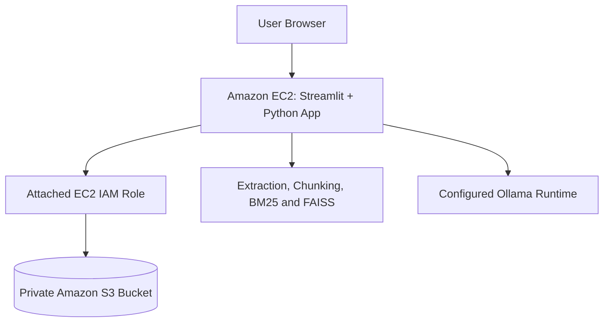

# Solstice Learning – Docs Q&A Assistant
## Technical Design Document

## 1. Problem statement

Solstice Learning support teams repeatedly answer administrator questions whose answers are documented in internal product materials. The application provides a document-grounded question-answering workflow so users can ask questions in natural language and receive answers supported by source passages.

The system must avoid unsupported answers. When the available evidence is insufficient, it must return this exact response:

`I don't have an answer for that.`

## 2. Goals

- Accept internal documents through an administrator-facing upload workflow.
- Preserve original uploaded documents in private object storage.
- Extract, chunk, and index document content.
- Retrieve relevant passages using both keyword and vector search.
- Generate answers with an Ollama-hosted language model using retrieved passages as context.
- Display source information for generated answers.
- Refuse to answer when the evidence does not support a reliable response.

## 3. Architecture overview

The Streamlit application runs on Amazon EC2. Streamlit handles the user interface and calls the Python ingestion, retrieval, and question-answering functions directly; a separate Flask API is not part of this design.

Amazon S3 stores original uploaded documents. The EC2 application uses Boto3 and its attached IAM role to access the bucket. Document extraction, chunking, BM25 indexing, embedding generation, and FAISS indexing are handled by the application on EC2.

Ollama provides the language-model runtime. The application sends the question and selected document passages to the configured Ollama model when the evidence gate allows answer generation. The selected Ollama model is `qwen2.5:1.5b` (Qwen 2.5 1.5B). Ollama may run on the EC2 host or on a separately configured machine; the deployment endpoint must match the actual project configuration.

## 4. Technology responsibilities

| Technology | Responsibility |
|---|---|
| Python | Application logic, ingestion, retrieval, and answer orchestration |
| Streamlit | User interface and direct invocation of Python functions |
| Amazon EC2 | Hosts the Streamlit application and document-processing/retrieval components |
| Amazon S3 | Stores original uploaded documents privately |
| Boto3 | Python SDK used for S3 operations |
| EC2 IAM role | Provides the application's required AWS permissions without embedding access keys |
| `rank-bm25` | Lexical keyword retrieval |
| Sentence Transformers `all-MiniLM-L6-v2` | Generates embeddings for document chunks and questions |
| FAISS | Stores/searches vectors for similarity-based retrieval |
| Ollama | Runs the configured language model used for answer generation |
| Qwen 2.5 1.5B (`qwen2.5:1.5b`) | The selected Ollama model for grounded answer generation |

FAISS does not generate embeddings; the Sentence Transformers model performs that task. BM25 is lexical retrieval, while FAISS supports vector similarity retrieval.

## 5. Document ingestion

### 5.1 Ingestion sequence

1. Administrator selects and uploads a document through Streamlit.
2. Application validates the file type and upload.
3. Original document is uploaded to the private S3 bucket using Boto3.
4. Application downloads a temporary working copy to EC2.
5. Text extraction produces the document's text content.
6. Text is divided into chunks.
7. Metadata is associated with each chunk.
8. Chunk text is tokenized for BM25 indexing.
9. Sentence Transformers generates embeddings for chunks.
10. FAISS is built or updated with the chunk vectors.
11. The document is marked searchable only after all required indexing steps succeed.
12. Temporary working files are cleaned up when processing is complete.

### 5.2 Initial chunking strategy

The initial strategy is:
- Three sentences per chunk.
- One-sentence overlap between consecutive chunks.
- Retain document ID, document title, and chunk ID with each chunk.

This is a starting configuration and may need adjustment based on document structure and retrieval quality.

### 5.3 Ingestion failure handling

- Keep the original S3 object if processing fails.
- Mark the document as failed rather than searchable.
- Do not expose a partially updated index as a successful ingestion.
- Allow the document to be processed again.
- Clean up temporary local files where possible.

## 6. Retrieval design

The query workflow uses two retrieval methods:

### 6.1 BM25 keyword retrieval

BM25 finds passages that share important terms with the user's question. It is useful for exact product terminology, setting names, error messages, and specific phrases.

### 6.2 FAISS vector retrieval

The question is embedded using the same Sentence Transformers embedding model used for document chunks. FAISS searches for vectors that are close to the question vector, helping retrieve passages with related meaning even when wording differs.

### 6.3 Candidate merging

The application combines candidates from BM25 and FAISS, removes duplicate chunks, and retains their source metadata. BM25 and FAISS scores have different meanings and scales; they should not be added directly without a deliberate normalization or ranking-fusion method.

## 7. Question answering and evidence gate

1. Receive the user's question.
2. Run BM25 keyword retrieval.
3. Generate the question embedding and run FAISS vector retrieval.
4. Merge and deduplicate the retrieved passages.
5. Evaluate whether the retrieved passages contain enough evidence to answer the question.
6. If evidence is insufficient, return exactly `I don't have an answer for that.` and do not call Ollama.
7. If evidence is sufficient, construct a prompt containing the question and retrieved passages.
8. Instruct the model to answer only from the supplied context and not to invent missing details.
9. Send the prompt to the configured Ollama model.
10. Return the answer with source information identifying the supporting document/chunk.

The evidence gate is important: a high retrieval score alone does not prove that a passage supports a factual answer. The sufficiency check should consider the actual content and coverage of the retrieved passages.

## 8. AWS deployment and security

- EC2 hosts the Streamlit application and Python processing/retrieval components.
- S3 stores original documents in a private bucket.
- Boto3 performs S3 operations.
- The EC2 instance role should grant only the S3 permissions required by the application.
- Do not hardcode AWS credentials in the repository.
- Configure the Ollama endpoint and model name for the actual deployment.
- If Ollama runs on a different machine, ensure the EC2 application can securely reach that endpoint. Do not expose the Ollama service publicly without appropriate network controls.

The selected model is `qwen2.5:1.5b`. The exact S3 bucket name, AWS region, EC2 configuration, and Ollama endpoint are deployment-specific and should be taken from the real environment.

## 9. Error handling

| Situation | Expected behavior |
|---|---|
| Invalid upload | Reject the file and show a useful validation message |
| S3 upload failure | Report the failure; do not start ingestion as if upload succeeded |
| Text extraction failure | Mark ingestion as failed and retain the original S3 file |
| Indexing failure | Do not mark the document searchable; permit retry |
| No useful retrieved evidence | Return the exact refusal |
| Ollama unavailable | Report a model-service error; do not fabricate an answer |
| Model response unsupported by context | Treat grounding as a quality/safety concern and improve validation or prompting |

## 10. Design considerations and limitations

- The initial three-sentence chunk size is simple and may not preserve all document structures, such as tables and headings.
- Hybrid retrieval can improve coverage, but score fusion needs a defined method if scores are combined numerically.
- Evidence sufficiency is a separate requirement from retrieval ranking.
- The configured Ollama model is `qwen2.5:1.5b`; its deployment endpoint must match the actual environment.
- Source metadata must remain attached through retrieval so citations can be displayed.
- Index persistence, concurrent uploads, document deletion, and index rebuild behavior should be verified against the implementation.

## 11. Potential future improvements

- Structure-aware chunking for headings, tables, and lists.
- Reranking of retrieved passages.
- Evaluation dataset for answer correctness, retrieval quality, and refusal accuracy.
- Document versioning and deletion workflows.
- Monitoring for ingestion failures, retrieval latency, and Ollama availability.
- Authentication and role-based access for administrators and users.
