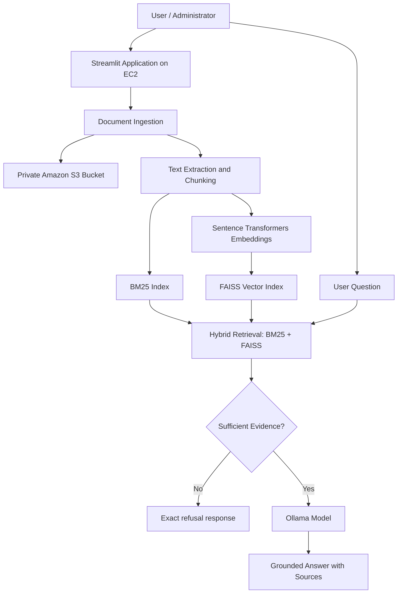

# Solstice Learning – Docs Q&A Assistant

A document-grounded question-answering assistant for Solstice Learning support teams. Administrators can upload internal product documentation, and users can ask natural-language questions. Answers are generated using a locally hosted language model through Ollama and are grounded in retrieved document passages.

If the available documents do not contain sufficient evidence to answer a question, the application returns the exact response:

`I don't have an answer for that.`

## Features

- Upload and process internal documents.
- Store original uploaded documents in a private Amazon S3 bucket.
- Extract text and split it into overlapping chunks.
- Retrieve relevant passages using BM25 keyword search and FAISS vector search.
- Generate answers using an Ollama-hosted language model.
- Display source information alongside answers.
- Refuse to answer when the retrieved evidence is insufficient.

## High-level architecture

## Technology stack

| Component | Technology | Responsibility |
|---|---|---|
| Application UI | Streamlit | Upload interface and question-answering experience |
| Application host | Amazon EC2 | Runs the Streamlit app, ingestion, and retrieval code |
| Original document storage | Amazon S3 | Stores uploaded source documents |
| AWS integration | Boto3 | Uploads and downloads documents from S3 |
| Access control | EC2 IAM role | Grants the application required S3 permissions without hardcoded AWS keys |
| Keyword retrieval | `rank-bm25` | Finds passages using lexical term matching |
| Embeddings | Sentence Transformers (`all-MiniLM-L6-v2`) | Converts text and questions into vectors |
| Vector retrieval | FAISS | Searches for semantically similar chunks |
| LLM runtime | Ollama | Runs the selected language model for answer generation |
| LLM model | `qwen2.5:1.5b` | Generates grounded answers from retrieved document passages |

## Main workflows

### Document ingestion

1. An administrator uploads a document through Streamlit.
2. The application validates the upload and stores the original file in the private S3 bucket.
3. The application downloads a temporary working copy to EC2 for processing.
4. Text is extracted and divided into chunks. The initial chunking strategy is three sentences per chunk with a one-sentence overlap.
5. Chunk metadata, such as document ID, title, and chunk ID, is retained.
6. The application builds the BM25 and FAISS indexes.
7. The document is marked searchable only after indexing succeeds.

### Question answering

1. A user submits a question through Streamlit.
2. BM25 performs keyword retrieval, while FAISS performs vector similarity retrieval.
3. The retrieved candidates are merged and deduplicated.
4. An evidence-sufficiency check determines whether the passages support an answer.
5. If evidence is insufficient, the application returns `I don't have an answer for that.`
6. If evidence is sufficient, the question and retrieved passages are sent to the configured Ollama model.
7. The generated answer and its supporting source information are shown to the user.

## Configuration notes

Configure the application to use the Ollama model `qwen2.5:1.5b`. Set the Ollama endpoint if it is not running on the same host. Keep environment-specific values in configuration or environment variables rather than hardcoding them.

AWS access should use the EC2 instance's IAM role for S3 access. Do not put AWS access keys in source code.

The configured model is `qwen2.5:1.5b`. The Ollama deployment location, AWS region, S3 bucket name, and repository-specific run commands should be documented from the actual project configuration rather than guessed.

## Detailed design

See [DESIGN_DOCUMENT.md](DESIGN_DOCUMENT.md) for the architecture, ingestion and retrieval flows, evidence gate, deployment considerations, and error handling.
