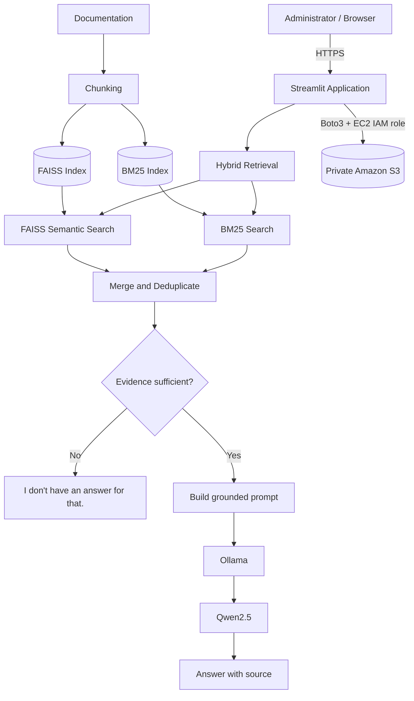
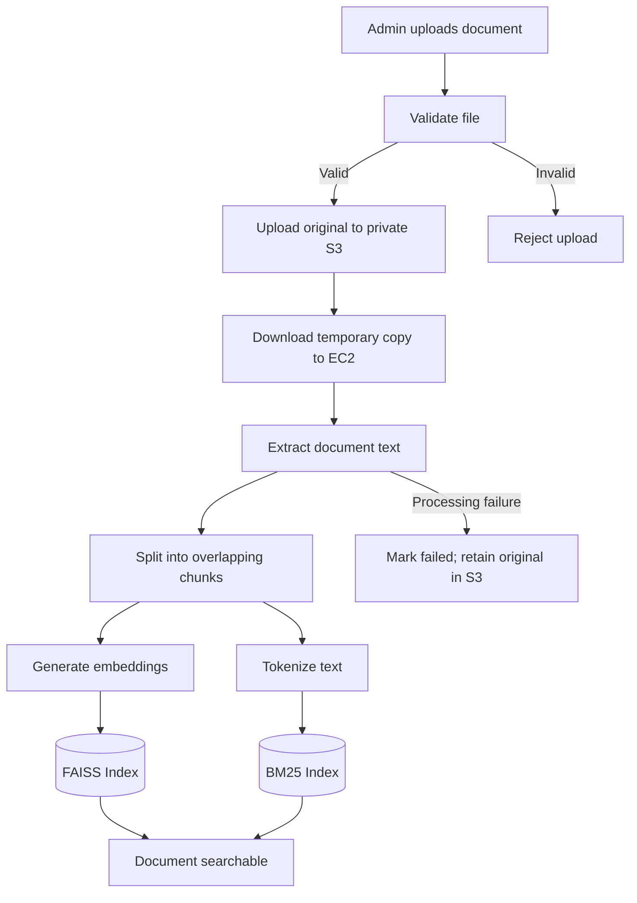
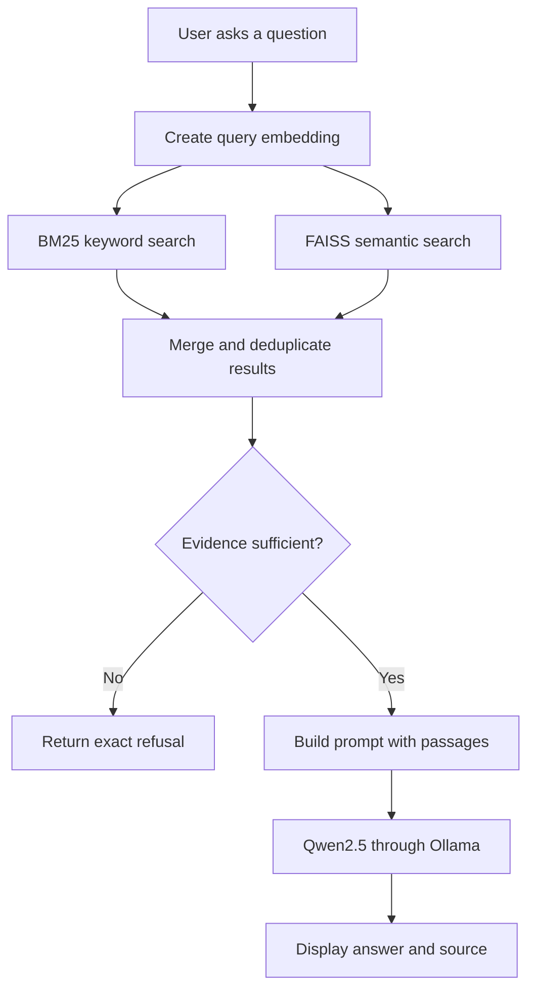
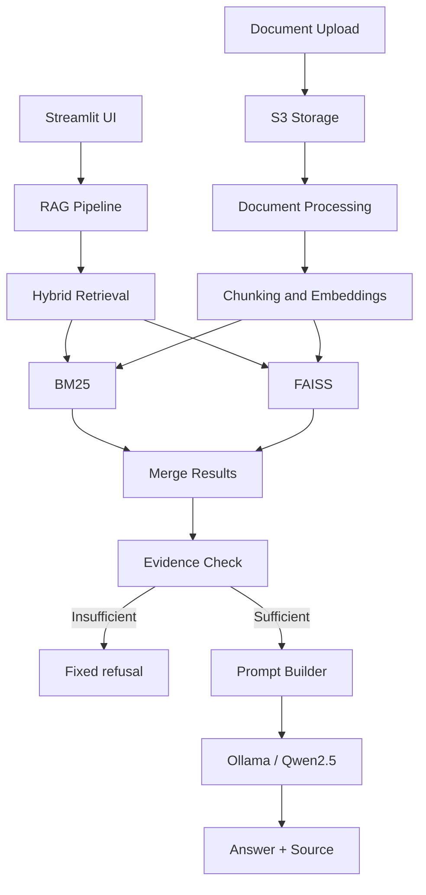
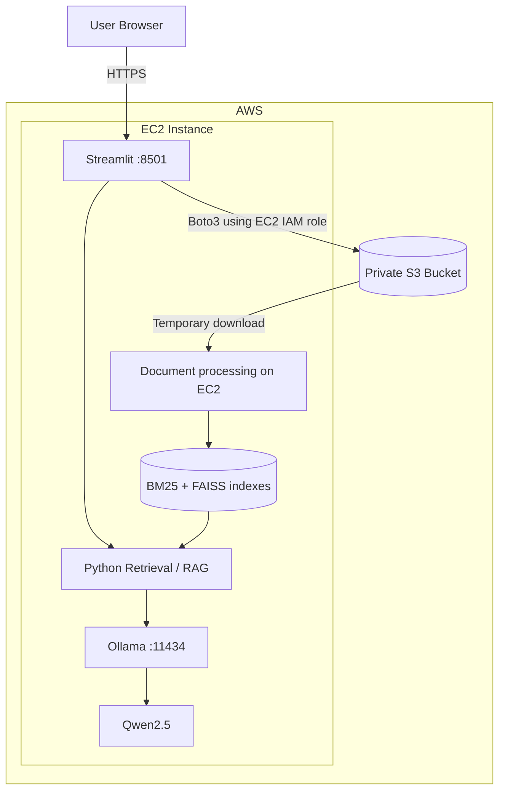

# Solstice Learning — Docs Q&A Assistant

A documentation-grounded question-answering assistant that helps corporate learning administrators find answers in product documentation. It retrieves relevant passages, generates answers from those passages, cites sources, and refuses when the documentation does not support an answer.

## 1. Project overview

Solstice Learning is an online-course platform for corporate training teams. Administrators repeatedly ask Support questions about password resets, export limits and billing cycles, even though answers already exist in product documentation.

The assistant lets an administrator ask a question in plain English. It searches the documentation, checks whether the retrieved passages provide enough evidence, and uses an LLM to formulate an answer from that evidence.

If the documentation does not contain the answer, it must return exactly:

```text
I don't have an answer for that.
```

**Core principle:** the LLM phrases the answer; the documentation supplies the facts.

## 2. Main features

- Natural-language question answering through Streamlit.
- Hybrid retrieval using BM25 keyword search and FAISS semantic search.
- Document chunking with metadata for focused retrieval and citations.
- Evidence sufficiency check before answer generation.
- Grounded answer generation using Qwen2.5 through Ollama.
- Source references so users can verify answers.
- Fixed refusal when the documentation does not support an answer.
- Admin document upload and storage in private Amazon S3.

## 3. Architecture

The application runs on an Amazon EC2 instance. Streamlit provides the interface and invokes the Python retrieval workflow. Ollama serves Qwen2.5 locally. Original uploaded documents are stored in a private S3 bucket.



### Main components

| Component | Responsibility |
|---|---|
| Streamlit | User interface and Python workflow orchestration. |
| EC2 | Hosts the application, retrieval components and local model runtime. |
| S3 | Stores original uploaded documents privately. |
| Boto3 | Connects the Python application to S3 for upload/download operations. |
| BM25 | Finds exact words, terms, identifiers and values. |
| Sentence Transformers | Converts questions and passages into embeddings. |
| FAISS | Searches embeddings for semantically similar passages. |
| Ollama + Qwen2.5 | Runs the LLM locally and generates grounded answers. |

## 4. Document upload and indexing pipeline

When an administrator uploads a document, the application validates it, stores the original in S3, processes a temporary working copy on EC2, and updates the retrieval indexes.



### Storage responsibilities

- **Amazon S3:** Stores original uploaded files durably in a private bucket.
- **EC2:** Temporarily holds downloaded files during processing and stores/uses the retrieval indexes and application runtime.
- **Boto3:** Python AWS SDK used by the application to communicate with S3.
- **IAM role:** Allows the EC2 instance to access the required S3 bucket without hardcoding AWS access keys.

Temporary files should be cleaned up after processing. If processing fails, retain the original in S3 and record the failure so it can be retried. Only make a document searchable after its indexing completes successfully.

## 5. Question-answering and RAG pipeline

RAG (Retrieval-Augmented Generation) retrieves relevant information first, then gives it to the LLM to formulate an answer.



1. BM25 finds lexical matches; FAISS finds semantically similar passages.
2. Results are combined and duplicate chunks are removed.
3. The evidence check determines whether the passages actually support an answer.
4. If evidence is sufficient, the question and passages are sent to Qwen2.5.
5. The answer is displayed with its source. If evidence is insufficient, the fixed refusal is returned.

Retrieval scores identify candidate passages; they do not by themselves prove that the content supports an answer. BM25 and FAISS scores should not simply be added because they use different scales.

## 6. Chunking approach

The initial design uses three sentences per chunk with a one-sentence overlap. Each chunk keeps metadata such as document ID, title and chunk ID.

```text
Article: S1 S2 S3 S4 S5 S6 S7

Chunk 0: S1 S2 S3
Chunk 1:       S3 S4 S5
Chunk 2:             S5 S6 S7
```

Overlap helps preserve context around chunk boundaries. Every sentence, including the final sentence, must appear in at least one chunk.

## 7. Technology stack

| Technology | Usage |
|---|---|
| Python | Main application and retrieval logic |
| Streamlit | Web interface |
| Amazon EC2 | Application and model hosting |
| Amazon S3 | Private storage for original documents |
| Boto3 / IAM role | Secure Python-to-S3 access |
| `rank-bm25` | Keyword retrieval |
| Sentence Transformers (`all-MiniLM-L6-v2`) | Text embeddings |
| FAISS | Vector similarity search |
| Ollama | Local LLM runtime |
| Qwen2.5:7b | Answer generation |

**Important distinctions:** FAISS searches vectors but does not create embeddings. Sentence Transformers creates embeddings. Ollama runs the model; Qwen2.5 is the model. BM25 is keyword-based retrieval, not semantic search.

## 8. Logical code flow

The exact repository files should be checked against the source code. This diagram shows the intended separation of responsibilities, not a verified list of filenames.



Typical logical responsibilities:
- **UI:** Accepts questions and uploads; displays answers and sources.
- **Storage layer:** Uploads and downloads original documents from S3 using Boto3.
- **Document processing:** Extracts text from supported file types.
- **Chunking and embeddings:** Creates passages and their vector representations.
- **Retrieval:** Searches BM25 and FAISS and combines results.
- **RAG pipeline:** Checks evidence, builds the prompt and calls Ollama.
- **Configuration:** Holds model, storage and retrieval settings.

Use the actual repository structure and function names when documenting the final implementation.

## 9. AWS deployment overview



- Browser requests reach the Streamlit application on the EC2 instance.
- Streamlit calls retrieval code directly and communicates with local Ollama.
- The EC2 IAM role grants the application the required S3 permissions.
- S3 stores originals; EC2 handles temporary processing and retrieval.
- Do not expose Streamlit port `8501` or Ollama port `11434` publicly. Restrict SSH access to a trusted IP.
- Configure HTTPS for shared deployments and keep AWS credentials and secrets out of source control.

## 10. Error handling and limitations

- **Unsupported or invalid upload:** Reject the file.
- **S3 upload failure:** Stop processing and report the failure.
- **Extraction or indexing failure:** Retain the original in S3, mark processing as failed and allow retry.
- **Ollama unavailable:** Show a clear model-unavailable message; do not claim an LLM-generated answer was produced.
- **Insufficient evidence:** Return exactly `I don't have an answer for that.`
- **Related but unsupported passage:** Do not infer an answer from topical similarity.

The prototype uses a single EC2 instance, so it is not highly available. Local model inference requires sufficient memory and CPU. Evidence sufficiency needs testing with answerable, paraphrased and unanswerable questions. No accuracy or latency figures should be claimed unless measured.

## 11. Future improvements

- Expand the evaluation set and measure retrieval and answer quality.
- Add more document formats and preserve document headings/versions.
- Improve support for questions requiring multiple documents.
- Add monitoring, backups and stronger production authentication.
- Separate application and model workloads if usage grows.

---

**Note:** Keep this README aligned with the actual source code. Mark any planned or partially implemented functionality clearly.
